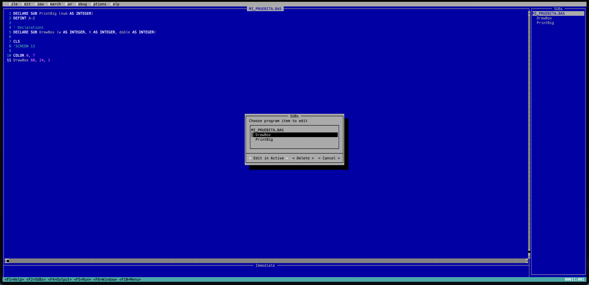
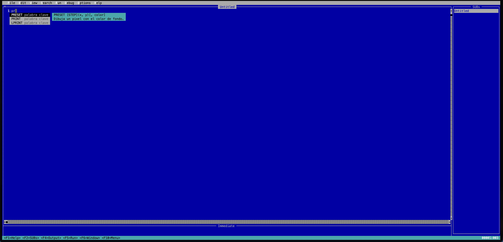

# goqb

IDE y compilador de **QuickBASIC 4.5** escritos en Go, con estética DOS y una interfaz de terminal que se adapta al tamaño de la ventana.
Hobby + nostalgia: volver a apretar F5 sobre un `.BAS` sin abrir un emulador.



> **In English.** goqb is a QuickBASIC 4.5 IDE and compiler written in Go. It runs in your
> terminal, looks like the original DOS editor and adapts to the window size. Programs are
> compiled to bytecode and run on a VM that follows QB's semantics: 16-bit integers with
> overflow, QB's number formatting and random generator, files, `ON ERROR`, `CHAIN`.
>
> It covers every graphics mode of QB 4.5 (SCREEN 1 to 13, drawn with kitty, iTerm2 or
> sixel images, half blocks, or a native window), PC-speaker sound with the full `PLAY`
> macro language, and a debugger with stepping, breakpoints, watches and an Immediate
> window. Programs that poke at the machine work too: there is an emulated 16-bit memory
> map, BIOS and DOS services, and an 8086 interpreter for `CALL ABSOLUTE`. *Make EXE*
> produces standalone executables for Linux, macOS and Windows. The editor adds a few
> modern touches: syntax colouring, completion with inline help, line numbers and mouse.
>
> The interface is in English like the original; the help texts and the rest of this
> README are in Spanish. Try it with
> `go build -o bin/goqb ./cmd/goqb && bin/goqb testdata/showcase.bas`.



## Instalación

```sh
go mod tidy            # la primera vez: completa go.sum
go build -o bin/goqb  ./cmd/goqb     # IDE
go build -o bin/goqbc ./cmd/goqbc    # línea de comandos
go build -tags window -o bin/goqbc ./cmd/goqbc   # opcional: con ventana nativa (ebiten, usa cgo)
go build -tags alsa -o bin/goqbc ./cmd/goqbc     # opcional en Linux: sonido (cgo + libasound2-dev)
scripts/build-stubs.sh                           # runtimes para Make EXE (en bin/stubs)
go test ./...
```

## Uso

```sh
bin/goqb programa.bas                 # IDE
bin/goqbc run programa.bas [args]     # ejecutar a pantalla completa (args → COMMAND$)
bin/goqbc run -plain programa.bas     # salida de flujo (tuberías, tests)
bin/goqbc run -window programa.bas    # ventana nativa (compilar con -tags window)
bin/goqbc check programa.bas          # verificar sin ejecutar
bin/goqbc check -I ~/qb45/include prog.mak
bin/goqbc build programa.bas          # ejecutable independiente (Make EXE)
bin/goqbc build -target windows/amd64 -o juego programa.bas
```

### Make EXE

`goqbc build` (o **Run → Make EXE File...** en el IDE) copia un runtime y le anexa el programa compilado: el resultado es un ejecutable que no necesita goqb ni los fuentes. Los argumentos que recibe forman `COMMAND$`. Para la plataforma actual alcanza con goqb/goqbc; para las demás, `scripts/build-stubs.sh` genera `goqbrt-<os>-<arch>` en `bin/stubs`, que se buscan junto al ejecutable de goqb, en su subdirectorio `stubs` o en `$GOQB_STUBS`.

Al ejecutarse en una terminal muestra *Press any key to continue* al terminar, porque si no la pantalla completa desaparece junto con la salida. Variables útiles: `GOQB_PLAIN=1` (salida de flujo), `GOQB_NOWAIT=1` (sin esperar una tecla), `GOQB_WINDOW=1` (ventana, si el runtime se compiló con `-tags window`).

En macOS todavía no está probado si los ejecutables firmados aceptan los datos anexados (Apple Silicon exige firma); si uno no arranca, avisame.

### Teclado del IDE

| Tecla | Acción |
|---|---|
| F1 | Ayuda de la palabra clave bajo el cursor (Help → Index lista todas) |
| F2 / Shift+F2 / Ctrl+F2 | Lista de SUBs / siguiente / anterior |
| F3 | Repetir búsqueda |
| F4 | Pantalla de salida |
| F5 / Shift+F5 | Continuar o ejecutar / ejecutar desde el principio |
| F6 | Alternar entre editor e Immediate |
| F7 | Ejecutar hasta el cursor |
| F8 / F10 / Shift+F8 | Paso / paso sin entrar en procedimientos / salir del procedimiento |
| F9 / Shift+F9 | Breakpoint / Instant Watch |
| F10 o Alt+letra | Menús (cuando el programa no está detenido) |
| Ctrl+C (Ctrl+Break) | Detener el programa |
| Shift+flechas, Shift+Del, Ctrl+Ins, Shift+Ins | Seleccionar, cortar, copiar, pegar (también Ctrl+X/C/V) |
| Ctrl+Y / Ctrl+Z / Ins | Borrar línea / deshacer / sobrescribir |

En macOS conviene activar "Option como Meta" en la terminal para que Alt+letra funcione; F10 y el mouse funcionan siempre.

El editor admite selección normal con Shift+flechas y por palabras con
Ctrl+Shift+izquierda/derecha. Alt+Shift+flechas selecciona un bloque rectangular.
También se puede activar **Edit → Column Selection** y usar Shift+flechas para
seleccionar columnas sin depender de Alt. El bloque se puede copiar, cortar,
borrar o reemplazar escribiendo o pegando texto; al copiar y pegar dentro del IDE
conserva su forma rectangular, y Ctrl+Z deshace la operación completa.
Command+Option+Shift+flechas sólo funciona si la terminal transmite los
modificadores; no se puede capturar una combinación que macOS o la terminal
intercepte. Estos atajos usan el portapapeles interno del IDE.

En Terminal de macOS, si Shift+izquierda/derecha selecciona pero
Shift+arriba/abajo no, configurá **Terminal → Configuración → Perfiles →
Teclado** en el perfil que usás. Agregá estas combinaciones con la acción
**Enviar texto**:

| Tecla | Modificador | Texto enviado |
|---|---|---|
| Flecha arriba | Shift | `\033[1;2A` |
| Flecha abajo | Shift | `\033[1;2B` |

`\033` representa el carácter Escape real: en el campo de texto presioná
Escape y luego escribí `[1;2A` o `[1;2B`. Terminal suele mostrar ese carácter
como `\033`. No envíes los caracteres literales de la cadena `\033`.
Sin estos mapeos, Terminal puede enviar las mismas secuencias que para las
flechas normales; el IDE no puede reconstruir el modificador Shift.

## Estado

| Fase | Contenido | Estado |
|---|---|---|
| 1 | Lexer, parser, `$INCLUDE`, `.MAK`, chequeos estructurales | ✅ |
| 2 | Compilador a bytecode, VM, runtime de texto, `goqbc run` | ✅ |
| 3 | IDE: editor con vista F2, menús, F5/F4, layout adaptable, formateo, Immediate | ✅ |
| 4 | Gráficos: SCREEN 1/2/7–13 en bloques, kitty, iTerm2, sixel o ventana | ✅ |
| 5 | Sonido (`SOUND`, `PLAY`, `BEEP`) y eventos (`ON TIMER/KEY/PLAY`) | ✅ **MVP** |
| 6 | Depurador: F8/F10, breakpoints, Watch, watchpoints, Calls, History | ✅ |
| 7 | Make EXE (runtimes por plataforma), `CHAIN`, `RUN "archivo"` | ✅ |
| 8 | Memoria de 16 bits, 8086 para `CALL ABSOLUTE`/`INTERRUPT`, `INP`/`OUT`, ayuda F1, configuración | ✅ |

### Gráficos

Todos los modos de QuickBASIC 4.5: 1 y 2 (CGA), 3 (Hercules, 720×348 monocromo, 2 páginas), 4 (Olivetti/AT&T, 640×400 con un color elegido con `COLOR`), 7 a 10 (EGA), 11 y 12 (VGA) y 13 (VGA 256 colores). Los modos 5 y 6 nunca existieron en QB y dan *Illegal function call*, igual que en el original. Soportan `PSET`, `PRESET`, `LINE` (con `B`/`BF` y estilo), `CIRCLE` (arcos y aspecto), `PAINT` (también con mosaicos), `DRAW`, `GET`/`PUT`, `VIEW`, `WINDOW`, `PMAP`, `POINT`, `PALETTE` (CGA/EGA/VGA), `PCOPY` y páginas. `PRINT` dibuja el texto con una fuente CP437 de 8×8. Cómo se ve depende del backend, que se elige solo:

| Backend | Terminal | Calidad |
|---|---|---|
| `kitty` | kitty, Ghostty | imagen completa |
| `iterm` | iTerm2, WezTerm | imagen completa |
| `sixel` | terminales con sixel (`GOQB_GFX=sixel`) | imagen completa |
| `blocks` | cualquiera (Terminal.app, tmux…) | medios bloques `▀`, menor resolución |
| ventana | `goqbc run -window` (build con `-tags window`) | fidelidad total |

`GOQB_GFX=blocks|kitty|iterm|sixel` fuerza un backend.

**Sin deformación**: la imagen siempre ocupa un área 4:3 centrada (como un monitor de la época), del tamaño que permita la terminal. Para calcularla hace falta la proporción alto/ancho de las celdas, que se obtiene, en este orden, de **Options → Graphics Aspect...** (o `GOQB_CELL_ASPECT=2.2`), del tamaño en píxeles que informe la terminal, o de preguntarle con las secuencias `CSI 16t`/`CSI 14t` al arrancar; si nada responde se asume 2. Si un círculo se ve ovalado, abrí **Options → Graphics Aspect...**: muestra un círculo dentro de un cuadrado en SCREEN 12 para ajustar el valor, que queda guardado en `config.json`. Al reducir la imagen en el backend de bloques, cada celda toma el color dominante de su zona sin perder las líneas de un píxel, y el texto impreso con `PRINT` en modo gráfico se reconoce en la imagen y se escribe con caracteres reales de la terminal (con sus colores), así se lee aunque la imagen esté reducida.

### Sonido y eventos

- **Sonido**: `SOUND`, `BEEP` y `PLAY` con todo el macrolenguaje (notas, `O`, `<`/`>`, `L`, `T`, `P`, `N`, `MN`/`ML`/`MS`, `MF`/`MB`) suenan con una onda cuadrada como el parlante de la PC. En macOS y Windows usan oto, sin cgo. En Linux hace falta compilar con `-tags alsa` (cgo y `libasound2-dev`; esta variante no está probada todavía); sin eso el modo es silencioso pero respeta los tiempos, así que los juegos que usan `PLAY` como pausa siguen andando.
- **Eventos**: `ON TIMER(n)`, `ON KEY(n)` (F1–F12, flechas, teclas definidas con `KEY 15..25`) y `ON PLAY(n)`, con `ON`, `OFF` y `STOP`. `ON PEN`, `ON STRIG`, `ON COM` y `ON UEVENT` se aceptan pero nunca se disparan.

### Depurador

F8 ejecuta una sentencia, F10 la ejecuta sin entrar en los SUB, Shift+F8 sigue hasta volver al llamador y F7 hasta la línea del cursor. F9 marca breakpoints (en rojo), **Debug → Set Next Statement** mueve la ejecución a la línea del cursor dentro del mismo procedimiento y **Calls** muestra la pila. **Add Watch** agrega expresiones que se recalculan en cada pausa en una banda sobre el editor (con el procedimiento en que se evalúan); **Watchpoint** detiene el programa cuando una expresión se hace verdadera; Shift+F9 evalúa al instante la variable o selección bajo el cursor. Con el programa detenido, la ventana Immediate ejecuta sentencias dentro del procedimiento actual y después se puede seguir. **History On** guarda las últimas 20 sentencias.

### CHAIN y RUN "archivo"

`CHAIN "PROG2"` carga otro programa conservando los archivos abiertos y las variables del `COMMON` sin nombre (por posición, como QB); `RUN "PROG2"` lo carga desde cero. Si el nombre no tiene extensión se prueban `.BAS` (que se compila al vuelo) y luego el ejecutable generado con Make EXE. Se buscan en el directorio actual y en el del programa principal, sin distinguir mayúsculas.

### Memoria y código máquina

`VARPTR`, `VARSEG`, `SADD`, `PEEK`, `POKE`, `DEF SEG`, `BLOAD` y `BSAVE` trabajan sobre una memoria de 16 bits emulada: las variables simples están en DGROUP (`&H1000`), cada array tiene su propio segmento, `&HB800` es la pantalla de texto, `&HA000` la de SCREEN 13 y el segmento 0 el área de datos del BIOS (teclado en `&H417`, reloj en `&H46C`, modo y columnas de video).

`CALL ABSOLUTE` ejecuta el código máquina en un 8086 emulado (con algunas instrucciones del 80186), y `CALL INTERRUPT`/`INTERRUPTX` llaman a los servicios emulados del BIOS y el DOS: INT 10h (cursor, scroll de ventanas, escribir caracteres, modo de video), 16h (teclado), 1Ah (reloj), 15h AH=86h (espera), 21h (caracteres, strings con `$`, fecha, hora, versión) y 33h (responde "sin mouse"). `INP`, `OUT` y `WAIT` emulan el retrazado vertical (`&H3DA`), la paleta VGA (`&H3C8`/`&H3C9`) y el timer. El 8086 corre a unos 4 millones de instrucciones por segundo para que las rutinas de demora en código máquina esperen algo parecido a lo que esperaban en su época; `GOQB_CPU_IPS` cambia la velocidad (0 = sin límite).

### Configuración

Las opciones del menú Options se guardan en `config.json` dentro del directorio de configuración del sistema (`~/.config/goqb` en Linux, `~/Library/Application Support/goqb` en macOS) o en `$GOQB_CONFIG`. Ahí también se puede agregar `"include_path": ["/ruta/a/qb45"]` para que `$INCLUDE: 'QB.BI'` se encuentre.

### Probado con

Los ejemplos de QBasic 1.1 son de Microsoft y no están en este repositorio; vienen con MS-DOS 5 y 6.

- `testdata/demo_graficos.bas`: gráficos, música de fondo y `ON TIMER`.
- `MONEY.BAS` de QBasic 1.1: el scroll de las listas usa `CALL ABSOLUTE` con código máquina que llama a INT 10h.
- `NIBBLES.BAS` de QBasic 1.1: anda completo, con un detalle. Calcula la velocidad con un `FOR` de 1000 vueltas, que en una máquina actual tarda menos que la resolución de `TIMER` y termina en `Division by zero`; al QBasic real le pasa lo mismo en hardware moderno. Para jugarlo, cambiá la línea `stopTime# = TIMER` por `stopTime# = TIMER: IF stopTime# - startTime# < .05 THEN stopTime# = startTime# + .05`.

### Paquetes

| Paquete | Qué hace |
|---|---|
| `lang/token`, `lang/lexer`, `lang/parser`, `lang/ast` | Frontend del lenguaje |
| `lang/source`, `lang/check` | Carga de módulos/includes y chequeos estructurales |
| `lang/cp437` | CP437 ↔ Unicode (los fuentes UTF-8 se transcodifican al compilar) |
| `lang/format` | Formateo de línea del editor |
| `compiler` | Análisis semántico + bytecode |
| `vm` | Máquina virtual, semántica numérica de QB, intrínsecas, archivos, `PRINT USING`, depurador, memoria de 16 bits, BIOS/DOS |
| `vm/x86` | Intérprete del 8086 para `CALL ABSOLUTE` |
| `runtime/screen` | Pantalla de texto virtual (80×25, 40/80 × 25/43/50) y teclado |
| `gfx` | Rasterizador de los modos gráficos, independiente de la presentación |
| `runtime/termrun` | Dibujo con tcell (paleta DOS), backends gráficos, teclas → `INKEY$`, ejecución a pantalla completa |
| `runtime/sound` | Sintetizador de onda cuadrada (oto) |
| `runtime/window` | Ventana nativa con ebiten (build tag `window`) |
| `runtime/bundle`, `runtime/launch`, `runtime/loader` | Make EXE, arranque de los ejecutables, carga de programas para `CHAIN`/`RUN` |
| `ide` | El IDE |

### Qué ejecuta hoy

- **Tipos y semántica numérica**: INTEGER de 16 bits con `Overflow`, LONG, SINGLE (float32), DOUBLE, STRING y `STRING * n`, TYPE (también anidados y en arrays). Redondeo bancario en `CINT`/`CLNG` y formato de números como QB (`.5`, `1E+07`, `1D+16`).
- **Variables**: sufijos, DEFtype, `AS`, arrays dinámicos y estáticos, arrays implícitos (0 a 10), `REDIM`, `ERASE`, `LBOUND`/`UBOUND`, `OPTION BASE`.
- **Procedimientos**: SUB y FUNCTION con pasaje por referencia (el default de QB), recursión, `STATIC`, `SHARED`, `DIM SHARED`, `COMMON SHARED`, DEF FN, CONST.
- **Control**: todo el control de flujo, `GOSUB`/`RETURN`, `ON GOTO/GOSUB`, `ON ERROR` + `RESUME` (también `NEXT` y a etiqueta) con `ERR`/`ERL`.
- **Datos y salida**: DATA/READ/RESTORE, PRINT con zonas, `TAB`/`SPC` y `USING`, WRITE, INPUT con "Redo from start", LINE INPUT.
- **Pantalla**: CLS, COLOR, LOCATE, WIDTH, VIEW PRINT, `SCREEN(f, c)`.
- **Memoria y hardware**: `PEEK`/`POKE`, `VARPTR`/`VARSEG`/`SADD`, `BLOAD`/`BSAVE`, `CALL ABSOLUTE`, `CALL INTERRUPT(X)`, `INP`/`OUT`/`WAIT` (ver más arriba).
- **Programas**: `CHAIN` con `COMMON`, `RUN "archivo"`.
- **Archivos**: modos INPUT, OUTPUT, APPEND, RANDOM (con TYPE o FIELD) y BINARY; EOF, LOF, LOC, SEEK, FREEFILE; KILL, NAME, MKDIR, FILES, SHELL.
- **Intrínsecas**: las funciones de string y matemáticas de QB, RND con el generador de QB 4.5, `MKI$`/`CVI` y el resto de esa familia.

Sin implementar: `IOCTL`, `ON PEN/STRIG/COM` (se aceptan pero no se disparan) y el mouse por INT 33h.

### IDE

- **Vista por procedimiento como QB**: al escribir `SUB Nombre` se crea su vista. F2 lista los procedimientos. Al guardar se genera un `.BAS` plano con los `DECLARE` automáticos, en la misma codificación (CP437 o UTF-8) y con el mismo fin de línea que el original.
- **Vista completa** (View → Full Program): todo el archivo en un solo editor, como en los editores actuales. El panel SUBs, F2 y Shift+F2 llevan al encabezado de cada procedimiento; al escribir `SUB Nombre` se agrega su `END SUB`. Al desactivarla el programa se vuelve a separar en vistas. La elección se guarda en `config.json` (`full_view`).
- **Al salir de cada línea**: se aplica el formateo y se verifica la sintaxis, con el diálogo de error de QB y el cursor en la columna del error.
- **Ejecución**: F5 ejecuta y al terminar muestra *Press any key to continue*. Ctrl+Break detiene y F5 continúa. Los errores de runtime ubican el cursor en la sentencia que falló.
- **Immediate**: ejecuta sentencias con acceso a las variables del programa (también dentro del procedimiento detenido).
- **Ayuda**: F1 sobre una palabra clave muestra su sintaxis; Help → Index lista todas.
- **Sugerencias al escribir** (al estilo IntelliSense): desde la segunda letra aparece una lista con palabras clave, funciones intrínsecas, los SUB/FUNCTION del programa, constantes y variables, con la sintaxis de la opción elegida al costado. Al comienzo de una sentencia se ordenan primero las sentencias; dentro de una expresión, variables y funciones. Tab acepta; Enter acepta solo si se eligió con las flechas (si no, termina la línea); Esc cierra; Ctrl+Espacio la abre en cualquier momento. Mientras se escribe una sentencia o los argumentos de una función, la barra de estado muestra su sintaxis.
- **Mouse**: un clic después del final del texto deja el cursor al final de esa línea.
- **Tabulaciones**: Options → Tab Stops (1 a 16, por defecto 8 como QB); se guarda en `config.json` como `tab_size`.
- **Coloreo de sintaxis** (Options → Syntax Coloring): palabras clave, funciones intrínsecas, strings, números, comentarios, metacomandos y etiquetas.
- **Números de línea** (Options → Line Numbers): numeración por vista, igual que la posición de la barra de estado; un clic en el número lleva al inicio de esa línea.
- **Layout adaptable**: panel lateral de SUBs desde 100×30; el clásico de 80×25; modo compacto (sin Immediate) por debajo de 80×20; aviso por debajo de 40×12.

## Licencia

[MIT](LICENSE), para el código de goqb.

La fuente de 8×8 viene de [dhepper/font8x8](https://github.com/dhepper/font8x8) (dominio público). Los programas de ejemplo de QBasic 1.1 que se mencionan más arriba (`GORILLA.BAS`, `MONEY.BAS`, `NIBBLES.BAS`) son de Microsoft y no se distribuyen con goqb.

QuickBASIC y QBasic son marcas de Microsoft. Este proyecto es independiente y no tiene relación con Microsoft.
